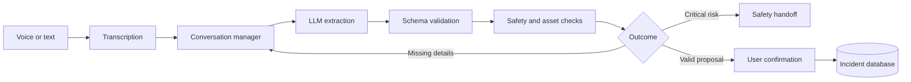

# Voice-First Field Incident Agent

A conversational voice agent for maintenance technicians. It transcribes an incident report, extracts structured details, handles corrections, applies safety rules, and asks for confirmation before creating a ticket.

**Stack:** Python · FastAPI · Groq · SQLite · JavaScript · Pytest

## 1. Build an LLM-powered voice agent



- Multi-turn incident intake with corrections and clarifying questions.
- Browser audio recording and server-side speech-to-text; text input remains available.
- Explicit confirmation before normal ticket creation.
- Critical safety indicators stop the normal ticket flow.

## 2. Own the end-to-end lifecycle

The project covers workflow scoping, system design, implementation, automated tests, a local demo, and iteration from evaluation failures.

**Backend highlights:**
- Separate conversation management, LLM extraction, policy, orchestration, asset validation, and persistence.
- Idempotency keys and replay handling to prevent duplicate ticket creation on repeated confirmation.
- Database transactions and confirmation-event records for auditable side effects.
- Bounded audio uploads, validated model output, and explicit provider-error handling.

These are distributed-systems reliability patterns. The current demo is single-process, uses in-memory conversation coordination, and persists to local SQLite; multi-replica deployment is not implemented.

## 3. Prompts, evaluation, and reliability

The model extracts incident facts; backend code owns severity, authorization, workflow state, and ticket creation.

| What is checked | How |
|---|---|
| Extraction format | Strict schema validation; reject backend-owned fields |
| Conversation continuity | Tests for corrections, confirmation, and follow-up replies |
| Safety | Critical cases must not create normal tickets |
| Retry safety | Repeated confirmation must not duplicate an incident |
| API failures | Tests for invalid media, oversized audio, empty transcripts, and provider errors |

Run the test suite:

```powershell
.\.venv\Scripts\python.exe -m pytest -q
```

Latency and transcription accuracy should be measured on representative audio before making production-performance claims.

## 4. Workflow and implementation readiness

The prototype maps a technician's workflow to explicit acceptance checks:

| Workflow need | Acceptance check |
|---|---|
| Report an equipment issue | Audio is transcribed or text can be entered |
| Correct the asset or symptom | The pending proposal updates in the same conversation |
| Handle a critical hazard | Safety handoff; no normal ticket is created |
| Submit a ticket | Nothing is created before explicit confirmation |
| Recover from a retry | Confirmation replay does not create a duplicate |

For a customer or Implementation Manager handover, confirm required fields, authorized assets, escalation rules, approval roles, provider-failure behavior, and integration requirements before go-live. This repository contains a synthetic local demo, not a completed customer deployment.

## Run locally

Install dependencies:

```powershell
.\.venv\Scripts\python.exe -m pip install -e ".[web,groq,dev]"
```

Set `GROQ_API_KEY` in your terminal, then start the demo:

```powershell
.\.venv\Scripts\python.exe .\scripts\run_voice_demo.py
```

Open the localhost URL printed in the terminal. Use synthetic incident data. Live transcription/extraction calls may consume provider quota; automated tests use fake clients.

## Current scope

Turn-based voice, not streaming full-duplex conversation. Tickets are stored in the local demo database; no external maintenance system or emergency service is contacted. Shared state, production monitoring, and multi-instance deployment remain future work.
